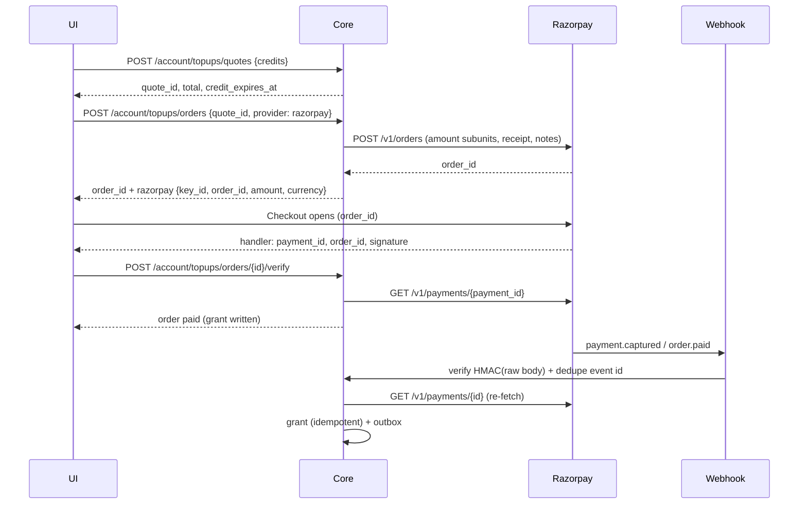
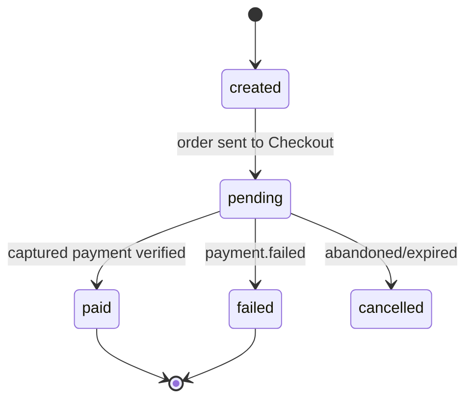

# Razorpay Top-up Integration — Backend Specification

How the Core service should integrate Razorpay for **QR credit top-ups** (and, later,
activation payments). Companion docs: `SUBSCRIPTION_PLAN_API_IMPLEMENTATION.md`,
`CUSTOMER_SUBSCRIPTION_DASHBOARD_UI.md`.

> **Golden rule:** credits are granted only after the server verifies a **captured**
> payment (webhook re-fetched from Razorpay, or a signature-verified verify call).
> A browser redirect, the Checkout `handler` alone, or the frontend polling result
> must never grant credits.

---

## 1. Credentials you must obtain from Razorpay

Generate them in the Razorpay Dashboard → **Account & Settings → API Keys**. Test
and Live are separate key pairs — never mix them.

| Env var | Where it comes from | Visibility | Purpose |
| --- | --- | --- | --- |
| `RAZORPAY_KEY_ID` | Dashboard → API Keys → **Generate Key** (Test or Live) | Public (safe in Checkout) | HTTP Basic username; `checkout.js` `key` option |
| `RAZORPAY_KEY_SECRET` | Generated together with the Key ID (shown once) | **Server only** | HTTP Basic password; payment-signature HMAC key |
| `RAZORPAY_WEBHOOK_SECRET` | Dashboard → **Webhooks → Add New Webhook**; you choose the secret | **Server only** | HMAC key to validate `X-Razorpay-Signature` |
| `RAZORPAY_MODE` | Your config | Server only | `test` \| `live` — used for logging/guards only |
| `RAZORPAY_BASE_URL` | Constant | Server only | `https://api.razorpay.com/v1` |

Additional dashboard settings you need (no keys):

- **Payment Capture** → set to **Auto-capture** (otherwise uncaptured payments auto-refund).
- **Payment methods** → enable UPI / cards / netbanking / wallets as required by your merchant account.
- **International payments** → enable only if you charge non-INR currencies (see §9).
- **Webhook URL** → public HTTPS endpoint, e.g. `https://core.example.com/api/v1/payments/webhooks/razorpay`.

Store all secrets in the secret manager / environment — never in the repo, never in
the frontend bundle, never in logs. A leaked `key_secret` allows order tampering and
signature forgery.

### What the frontend receives

Only `key_id` (and the `order_id`). The backend returns them inside the top-up order
response (already consumed by the platform app):

```json
{
  "order_id": "…", "status": "pending", "amount": "268.75",
  "currency": "INR", "credits": "5000.000000", "provider": "razorpay",
  "razorpay": { "key_id": "rzp_test_…", "order_id": "order_…", "amount": 26875, "currency": "INR" }
}
```

---

## 2. Razorpay APIs used

| Razorpay API | When | Auth |
| --- | --- | --- |
| `POST /v1/orders` | Create an order for every top-up checkout attempt | Basic `key_id:key_secret` |
| `GET /v1/orders/{order_id}` | Reconcile/lookup | Basic |
| `GET /v1/payments/{payment_id}` | **Authoritative** payment status before granting | Basic |
| `POST /v1/payments/{payment_id}/capture` | Only if you opt out of auto-capture | Basic |
| `POST /v1/payments/{payment_id}/refund` | Refund/dispute handling (optional) | Basic |
| `POST /v1/payment_links` | Optional hosted-link fallback (`checkout_url`) | Basic |
| `GET /v1/payments?count=&skip=` | Reconciliation job (optional) | Basic |

Notes from the Razorpay docs that matter here:

- `amount` is an **integer in the smallest currency unit** (paise for INR).
- `receipt` must be **unique**, ≤ 40 ASCII characters. Razorpay rejects duplicates, giving
  provider-level idempotency — use your `topup_orders.id`.
- An order is required for every payment; payments without `order_id` cannot be captured
  and are auto-refunded.
- A new order must be created for every **payment attempt** (do not reuse an order after
  a failure). Create it when the customer clicks *Pay now*.
- Order states: `created → attempted → paid` (paid = a payment for it was captured).
- Pass `notes` (`organization_id`, `quote_id`, `topup_order_id`) so webhooks and the
  Razorpay dashboard are traceable.

---

## 3. Backend endpoints to implement (public contract)

### 3.1 `POST /api/v1/account/topups/orders`

Headers: `Authorization: Bearer <org JWT>`, `Idempotency-Key: <uuid>`, `Content-Type: application/json`.

Request: `{ "quote_id": "…", "provider": "razorpay" }`

Steps:

1. Load the quote scoped to the JWT organization; reject if missing, expired,
   `consumed_at` set, or currency/price changed.
2. Reuse an existing order for the same `Idempotency-Key` (return it with `Idempotency-Replayed: true`).
3. `amount_subunits = int(Decimal(quote.total) * 10 ** currency_exponent)` — assert it is a positive integer.
4. Call `POST /v1/orders`:

```json
{
  "amount": 26875,
  "currency": "INR",
  "receipt": "<topup_orders.id>",
  "partial_payment": false,
  "notes": { "organization_id": "…", "quote_id": "…", "topup_order_id": "…" }
}
```

5. Persist `provider='razorpay'`, `provider_order_id`, `amount_subunits`, `currency`, `status='pending'`.
6. Return the response shape in §1 (include `razorpay.key_id/order_id/amount/currency`).

Errors: `400 INVALID_QUOTE`, `409 IDEMPOTENCY_CONFLICT`, `402 SUBSCRIPTION_INACTIVE`,
`422 UNSUPPORTED_PROVIDER`, `502 PROVIDER_UNAVAILABLE`.

### 3.2 `POST /api/v1/account/topups/orders/{order_id}/verify`

Fast path called by the Checkout `handler`. Body:

```json
{
  "razorpay_payment_id": "pay_…",
  "razorpay_order_id": "order_…",
  "razorpay_signature": "…"
}
```

1. Load the top-up order (JWT org, must be pending).
2. Compute `HMAC_SHA256(f"{stored_provider_order_id}|{razorpay_payment_id}", key_secret)`.
   **Use the stored order id**, not the one from the request, and compare with
   `hmac.compare_digest`.
3. `GET /v1/payments/{razorpay_payment_id}` and assert `order_id`, `amount`, `currency`,
   `status == "captured"` (or `authorized` + capture, if you do it manually).
4. Grant through the same idempotent path as the webhook (§4.3) and return the order.
5. If verification fails: `401 SIGNATURE_INVALID`; mismatch: `422 INVOICE_TOTAL_MISMATCH`.

This endpoint is an optimisation. The webhook remains the source of truth; a missing
verify endpoint only means the UI falls back to polling.

### 3.3 `POST /api/v1/payments/webhooks/razorpay`

- Public HTTPS, **no auth**, but signature-verified.
- Read the **raw request body** (`await request.body()` in FastAPI) before any parsing.
- Verify `X-Razorpay-Signature == HMAC_SHA256(raw_body, RAZORPAY_WEBHOOK_SECRET)`.
  Reject with `401 SIGNATURE_INVALID` on mismatch. Never parse-then-re-serialize.
- Dedupe on the `x-razorpay-event-id` header (unique index) — replay returns `200` no-op.
- Subscribe to: `payment.captured`, `payment.failed`, `order.paid`, `refund.processed`
  (`payment.authorized` optional; `payment_link.paid` only if using payment links).
- Process each event in one DB transaction; enqueue an outbox event for notifications.
- Return `200` once persisted. A `5xx` makes Razorpay retry (it retries with backoff).

Event ordering is not guaranteed (`payment.captured` may arrive before `order.paid`).
Treat the grant as idempotent and ignore events that arrive after a terminal state.

### 3.4 `GET /api/v1/account/topups/orders/{order_id}` (existing)

Return the local status (`created|pending|paid|failed|cancelled`). Optionally reconcile
on demand: if pending for > 60s, call `GET /v1/orders/{id}` + `GET /v1/payments?...`
server-side and update before responding. This is what the UI polls.

---

## 4. Data model changes

### 4.1 `topup_orders`

```sql
ALTER TABLE topup_orders
  ADD COLUMN provider            VARCHAR(30)  NOT NULL DEFAULT 'razorpay',
  ADD COLUMN provider_order_id   VARCHAR(64),
  ADD COLUMN provider_payment_id VARCHAR(64),
  ADD COLUMN amount_subunits     BIGINT,
  ADD COLUMN currency            CHAR(3),
  ADD COLUMN paid_at             TIMESTAMPTZ,
  ADD COLUMN failure_reason      TEXT;

CREATE UNIQUE INDEX ux_topup_orders_provider_order
  ON topup_orders (provider, provider_order_id)
  WHERE provider_order_id IS NOT NULL;

CREATE UNIQUE INDEX ux_topup_orders_provider_payment
  ON topup_orders (provider, provider_payment_id)
  WHERE provider_payment_id IS NOT NULL;
```

### 4.2 `billing_provider_events`

```sql
CREATE TABLE billing_provider_events (
  id                UUID PRIMARY KEY DEFAULT gen_random_uuid(),
  provider          VARCHAR(30)  NOT NULL,
  provider_event_id VARCHAR(191) NOT NULL,
  event_type        VARCHAR(60)  NOT NULL,
  payload           JSONB        NOT NULL,
  signature_verified BOOLEAN     NOT NULL DEFAULT false,
  organization_id   UUID,
  processed_at      TIMESTAMPTZ,
  received_at       TIMESTAMPTZ  NOT NULL DEFAULT now(),
  CONSTRAINT ux_provider_event UNIQUE (provider, provider_event_id)
);
```

### 4.3 Grant idempotency

Credits are granted by inserting a batch with a **database-enforced uniqueness** so a
replayed webhook, a verify call and a retry can never double-grant:

```sql
-- already required by the architecture doc
credit_batches UNIQUE (organization_id, source_type, source_id)
-- top-up: source_type='topup', source_id = topup_orders.id
```

If the insert conflicts, treat it as already granted and return success.

---

## 5. Signature verification (exact algorithms)

### 5.1 Checkout payment signature (verify endpoint)

```python
import hmac, hashlib

def verify_payment_signature(stored_order_id: str, payment_id: str, signature: str, key_secret: str) -> bool:
    message = f"{stored_order_id}|{payment_id}".encode()
    expected = hmac.new(key_secret.encode(), message, hashlib.sha256).hexdigest()
    return hmac.compare_digest(expected, signature)
```

### 5.2 Webhook signature

```python
def verify_webhook_signature(raw_body: bytes, received: str, webhook_secret: str) -> bool:
    expected = hmac.new(webhook_secret.encode(), raw_body, hashlib.sha256).hexdigest()
    return hmac.compare_digest(expected, received)
```

Rules:

- Hex digest, SHA-256, constant-time compare.
- Raw body only — FastAPI: read `body = await request.body()` **before** `json.loads`.
- If the webhook secret was rotated, old retries must be validated with the old secret.
- Never trust `razorpay_order_id` from the client for the signature message.

---

## 6. Grant transaction (webhook + verify share this)

```
BEGIN
  UPDATE topup_orders
     SET status='paid', provider_payment_id=:pid, paid_at=now()
   WHERE id=:order_id AND organization_id=:org AND status <> 'paid';

  INSERT INTO credit_batches (organization_id, source_type, source_id, granted_qty, issued_at, expires_at, status)
  VALUES (:org, 'topup', :topup_order_id, :credits, now(), now() + interval '12 months', 'active')
  ON CONFLICT (organization_id, source_type, source_id) DO NOTHING;

  INSERT INTO credit_ledger (…, type='grant', qty=:credits, balance_after=:computed, reference_type='topup', reference_id=:topup_order_id, idempotency_key='grant:'||:topup_order_id)
  -- only if the batch insert actually inserted

  INSERT INTO outbox_events (organization_id, event_type, payload) VALUES (…, 'topup.paid', …);
COMMIT
```

Before granting, assert against the **re-fetched** payment/order:

- `payment.order_id == topup_orders.provider_order_id`
- `payment.amount == topup_orders.amount_subunits`
- `payment.currency == topup_orders.currency`
- `payment.status == "captured"` (auto-capture) or you capture it yourself
- organization in `payment.notes`/`order.notes` matches

Any mismatch → do not grant; log to reconciliation (`INVOICE_TOTAL_MISMATCH` / alert).

---

## 7. Flow diagrams





---

## 8. Failure, retry and reconciliation

- **Failed payment**: `payment.failed` → mark `failed`; never grant. Let the customer
  start a new quote/order (orders are single-attempt).
- **Duplicate webhook**: unique event id → `200` no-op.
- **Out-of-order events**: grant on the first terminal success event; ignore later ones.
- **Missed webhook**: a sweeper polls pending orders older than 2 minutes with
  `GET /v1/orders/{id}` and `GET /v1/payments?...` and grants idempotently.
- **Timeouts/5xx from Razorpay**: retry `GET` calls with backoff; for `POST /v1/orders`
  retry only when the failure is transport-level (the unique `receipt` protects you).
- **Reconciliation report**: expose unresolved provider events / orders to the existing
  `/admin/subscriptions/reconciliation` findings.

---

## 9. Currency and amounts

- Razorpay requires an integer in the currency's smallest unit. Rupee = 2 decimals →
  `× 100`; 3-decimal currencies (KWD/BHD/OMR) → `× 1000`; zero-decimal (JPY) → `× 1`.
- Never use floats. Use `Decimal` and round half-up.
- Razorpay is INR-first; non-INR requires international payments to be enabled and may
  involve currency conversion. Decide with finance whether plans priced in USD/AED are
  charged in INR equivalent or via Razorpay international.
- Reject partial payments (`partial_payment: false`) so a top-up is all-or-nothing.

---

## 10. Security checklist

- [ ] `key_secret` and `webhook_secret` only in the secret manager; never in the frontend,
      logs, or error messages.
- [ ] Webhook verifies HMAC over **raw bytes** with constant-time compare.
- [ ] `x-razorpay-event-id` unique index; replay-safe.
- [ ] Payment/order **re-fetched** from Razorpay before granting; amount, currency,
      order id and organization compared.
- [ ] Credits granted through the unique batch constraint (append-only ledger).
- [ ] Only `key_id` returned to the browser.
- [ ] No card data stored (PCI SAQ-A): Checkout handles PAN/CVV.
- [ ] Webhook endpoint excluded from auth but rate-limited and monitored.
- [ ] Audit log entries for order creation, verification, webhook processing and grants.
- [ ] Alerts on: signature failures, amount mismatches, pending orders > 10 min,
      duplicate grants, provider 5xx.

---

## 11. Testing

| Scenario | Expected |
| --- | --- |
| Test card `4100 2800 0000 1007`, any CVV/future expiry | Order paid, one batch, credits visible |
| UPI `success@razorpay` / `failure@razorpay` | Success grants once / failure grants nothing |
| Replay the same webhook 10× | One payment transition, one batch |
| Tampered `X-Razorpay-Signature` | `401`, no grant, alert |
| Amount/currency mismatch | Rejected, reconciliation finding |
| Expired/consumed quote | `400 INVALID_QUOTE` |
| Two orders for one `Idempotency-Key` | Same order returned, no double charge |
| Webhook missed; sweeper runs | Grant issued exactly once |
| Refund after grant | `refund.processed` recorded; no silent credit deletion |

Webhook testing: use Test mode and a **public staging URL**. Razorpay blacklists
`localhost`, `ngrok.io`, `webhook.site`, `requestbin.com`, `beeceptor.com`, `loca.lt`,
etc.; use `zrok` or your staging host. Editing a test-mode webhook asks for OTP `754081`.

---

## 12. Environment configuration

```dotenv
# Test (local/staging)
RAZORPAY_MODE=test
RAZORPAY_KEY_ID=rzp_test_xxxxxxxxxxxxxx
RAZORPAY_KEY_SECRET=xxxxxxxxxxxxxxxxxxxxxxxx
RAZORPAY_WEBHOOK_SECRET=whsec_local_random_string
RAZORPAY_BASE_URL=https://api.razorpay.com/v1

# Production — separate key pair from the Live dashboard
RAZORPAY_MODE=live
RAZORPAY_KEY_ID=rzp_live_xxxxxxxxxxxxxx
RAZORPAY_KEY_SECRET=xxxxxxxxxxxxxxxxxxxxxxxx
RAZORPAY_WEBHOOK_SECRET=whsec_prod_random_string
```

Never reuse a test webhook secret in live mode; rotate both secrets if exposed.

---

## 13. Implementation checklist

1. Obtain Test keys + create the Test webhook (events listed in §3.3); record the webhook secret.
2. Add the env vars to the Core service secret store for dev/staging.
3. Apply the DDL in §4 (orders columns, provider events, constraints).
4. Implement order creation (§3.1) and return the `razorpay` block.
5. Implement the verify endpoint (§3.2) with the payment-signature HMAC.
6. Implement the webhook (§3.3, §5.2) with raw-body verification and event dedupe.
7. Implement the shared grant transaction (§6) with the unique batch.
8. Point the platform app at the deployed API and run the §11 scenarios.
9. Enable auto-capture; add pending-order sweeper + reconciliation entries.
10. Repeat with Live keys and the Live webhook only after sign-off from finance.
